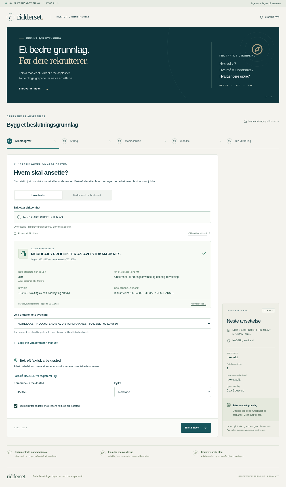
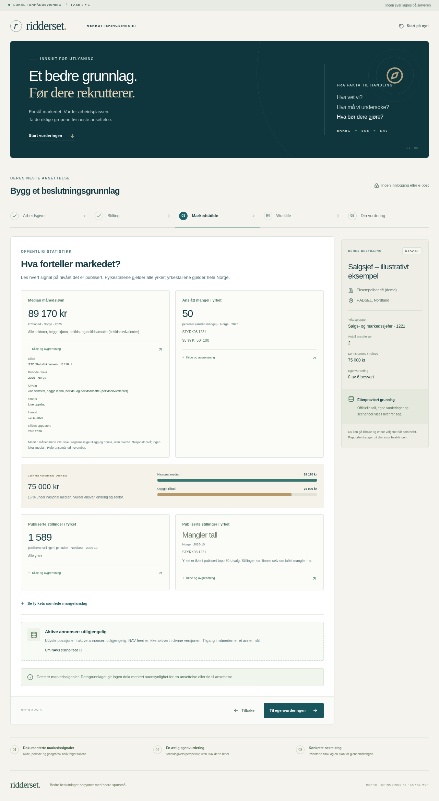

# Demonstrasjon og leveransestatus

Lokal fase 0/1, 12. november 2026. Ingen endring er gjort på ridderset.no.
Alle Worklife-svar i demonstrasjonen er hypotetiske og gjelder **Eksempelbedrift
(demo)**. Nordlaks brukes bare for faktiske, offentlige Brreg-oppslag.

## Se demonstrasjonen

- [Skjermopptak av flyten (WebM)](demo/walkthrough.webm)
- [Eksempelrapport (PDF)](demo/example-report.pdf)
- [Samme rapport som tekst](demo/example-report.txt)
- [Live kildekontroll, maskinlesbar](demo/live-source-check.json)






## Prøv selv

1. `npm ci && npm run dev`; åpne <http://localhost:5173>.
2. Søk «Nordlaks», velg NORDLAKS PRODUKTER AS og underenheten i Stokmarknes.
   Kontroller org.nr., antall personer, næring og kommune. Foreslå Hadsel og
   bekreft faktisk arbeidssted. Søk også direkte etter underenheter.
3. For hypotetisk egenvurdering: velg manuell registrering og bruk
   «Eksempelbedrift (demo)» uten org.nr. Registerdata er da ikke påstått verifisert.
4. Oppgi stillingstittel, søk «Salgsjef», velg 1221 og legg inn en tenkt lønn.
   Prøv også Tømrer, Sykepleier, Prosjektleder, Prosjektsjef, Rekrutterer,
   Elektriker, Driftstekniker, Kokk og Regnskapsfører.
5. Les markedsbildet, åpne «Kilde og avgrensning». Sammenlign nivåene:
   SSB/yrke/Norge, NAV/fylke/alle yrker og NAV/yrke/Norge.
6. Gå til Worklife: alle startverdier er ubesvart. Flytt skyvefeltene eller
   bekreft 5. Kontroller umiddelbar delscore, delvis svarstatus og HR-råd.
   Slå av illustrasjoner eller nullstill ved behov.
7. Aktiver et hypotetisk scenario og bygg rapporten. Last ned TXT/JSON eller
   skriv ut til PDF. Endre en opplysning; rapporten må da bygges på nytt.

For å gjenskape opptaket mot et lokalt produksjonsbygg:

```sh
npm run build
PORT=4180 npm start
# I en annen terminal:
DEMO_ORIGIN=http://127.0.0.1:4180 npm run demo
```

Kjør `npm run test:live` først; demoskriptet kopierer denne kildekontrollen.
`DEMO_ORIGIN` må være denne lokale appen. Skriptet gjør bare offentlige oppslag
og flyktige beregninger, og sender ingen e-post eller WordPress-endring.

## Konkret status

| Del                       | Status                                             | Praktisk begrensning                                                |
| ------------------------- | -------------------------------------------------- | ------------------------------------------------------------------- |
| Brreg                     | Live, også kontrollert mot faktisk API             | Registeradresse må bekreftes som arbeidssted; noen felt kan mangle  |
| Yrkessøk                  | 407 yrker og kontrollerte synonymer                | Flertydige titler må kontrolleres av bruker                         |
| SSB 11418                 | Live metadata og medianlønn med cache              | Nasjonal statistikk, publiseringslag, ingen lokal median            |
| SSB regionale kilder      | Seks gjennomgåtte metadataadaptere                 | Ingen regional kandidatmodell i fase 1                              |
| NAV stillingstilgang      | Verifisert snapshot jan.–okt. 2026                 | Fylker/alle yrker og separat nasjonal topp 30; ikke aktive annonser |
| NAV Bedriftsundersøkelsen | Verifisert snapshot 2026, 257 yrkeskoblinger og KI | Utvalgsanslag, ingen tilgjengelig kandidatpool                      |
| NAV aktiv feed            | Utilgjengelig, tydelig i UI/API/rapport            | Krever produksjonstilgang, vilkår, worker og indeks i fase 2        |
| Worklife/HR               | Fungerer med svarstatus og separate råd            | Egenvurdering, ingen validert måling/sertifisering                  |
| Rapport/scenario          | Fungerer, 5 tiltak og 30/60/90-plan                | Kvalitativ fortolkning; ingen rekrutteringsdato eller sannsynlighet |
| Deling                    | TXT/JSON og nettleser-PDF                          | Ingen lagret eller delbar rapportlenke                              |
| WordPress                 | Isolert staging-bro levert, ikke installert        | Faktisk WordPress-tema/iframe må testes i staging                   |

Ingen kjent blokkerende feil i den verifiserte lokale fase 1-flyten.
Testene dekker tilsiktede kildefeil og fallback. Produksjonsgodkjenning,
ekstern WordPress-verifikasjon og NAV fase 2 er separate neste steg.

## Testbevis

- `npm run check`: lint, strenge typer, 44 enhets-/API-kontrakttester og bygg.
- `npm run test:e2e`: 14 Chromium-tester, PC 1280×800 og mobil 390×844.
  Ekstra breddekontroll ved 360/390/768/1280/1920.
- Nettlesertester bruker produksjonsbygg + faktisk API-stakk med versjonerte
  kildesvar i en separat testserver. De er reproduserbare uten kildenes oppetid.
- `npm run test:live`: separat kontroll av faktiske Brreg-søk/underenheter,
  SSB-lønn, alle seks ekstra tabellmetadata og NAV-originalenes tilgjengelighet.
- Søkeforslag, tastatur, seks range-felt, 0/ukjent, ubesvart startverdi,
  kildefeil/retry, manuell fallback, utskriftskilder, nedlasting og rapportendring.
- En forsinket rapportforespørsel avbrytes når bestillingen endres, slik at en
  gammel respons ikke kan overta den nye bestillingen.

`npm run test:e2e` lager HTML-rapport, spor og feilbilder under
`playwright-report/` og `test-results/`. CI laster disse opp som artefakt og
har ingen deploy-jobb. Opptakstid og visningsstørrelser finnes i `demo/capture.json`.
